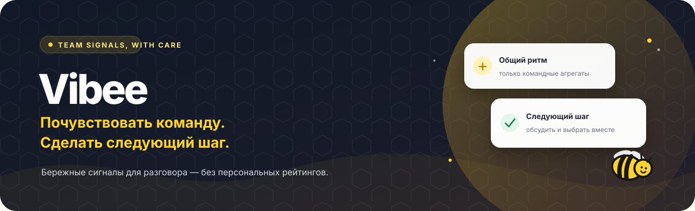
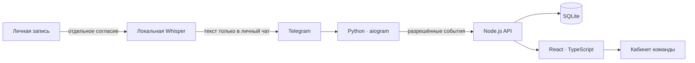

<div align="center">
  
  <br><br>
  <a href="https://github.com/augustteske/vibebot/actions/workflows/ci.yml"></a>
  <a href="https://github.com/augustteske/vibebot/actions/workflows/ci.yml"></a>
  <a href="LICENSE"></a>
  <a href="https://nodejs.org/"></a>
</div>

<p align="center">
  <strong>Vibee помогает команде замечать общий ритм общения и выбирать следующий полезный шаг.</strong><br>
  Без персональных рейтингов. С прозрачными ограничениями и уважением к согласию.
</p>

## Идея

В командных чатах легко не заметить, что общение сместилось на поздние часы, участие стало неравномерным, а благодарности звучат реже. Vibee превращает такие наблюдения в **бережные командные сигналы** и предлагает обсудить небольшое практическое действие.

Это исследовательский open-source прототип, а не система контроля сотрудников. Он описывает сообщения как агрегаты команды и не ставит людям оценки.

## Что уже есть

| Часть | Возможности | Статус |
| --- | --- | --- |
| **Веб-кабинет** | Пространства команды, чек-ины, показатели, расписание и карточка следующего действия | Рабочий прототип с демонстрационными сценариями |
| **API и хранение** | Node.js API, SQLite, роли и изоляция команд, согласия, закрытие периодов и публикация допустимых агрегатов | Локально проверенный прототип; обычное подключение Telegram выключено |
| **Telegram-бот** | Личный демо-чек-ин `/start` и отмена `/stop` | Можно запустить отдельно с собственным токеном |
| **Личная расшифровка** | `/transcribe` → согласие на одну запись → новое голосовое → текст в личном чате | Локальная Whisper-модель; требуется отдельно установить зависимости и веса |
| **Групповые сообщения и голос** | В коде есть intake новых сообщений и экспериментальный путь расшифровки голосовых | Не включать для реальных рабочих чатов: групповой сценарий ждёт отдельной политики расшифровки и согласования отзыва |

## Командные сигналы

В закрытом периоде прототип рассчитывает три описательные метрики:

- 🕒 **Вне рабочего расписания** — доля сообщений за пределами заданных интервалов команды.
- ⚖️ **Равномерность участия** — насколько сообщения распределены между составом команды, включая участников без сообщений.
- 🙌 **Явная благодарность** — доля сообщений с ограниченным набором слов благодарности.

Это подсказки для общего разговора, а не измерения продуктивности, благополучия или вклада конкретного человека. Если данных недостаточно или период ещё не готов, значения скрываются. Рекомендация по умолчанию строится из шаблона; поддерживается конфигурация Groq, OpenAI или Ollama, которой передаются только разрешённые агрегаты.

## Как устроено



Бот не обращается к SQLite напрямую. API отвечает за авторизацию, согласия, изоляцию команд и правила публикации; веб-кабинет показывает разрешённые результаты. Личная расшифровка не отправляет запись или результат в командный API.

## Приватность — часть продукта

- Для личной расшифровки нужно отдельное согласие на **одну** новую запись; разрешение живёт пять минут. `/stop` отзывает его и отменяет текущую обработку.
- Голосовое ограничено 60 секундами и 2 МиБ. После скачивания оно обрабатывается локально, через память и отдельный процесс. Приложение не сохраняет аудио и текст расшифровки в файлы, SQLite или журналы.
- Результат личной расшифровки отправляется обратно в Telegram и остаётся в истории Telegram. Пользователь должен иметь право передавать эту запись на обработку.
- Групповая расшифровка не готова для реального использования: текущая политика метаданных `synthetic-media-v1` её не разрешает. До отдельного согласия компании и каждого участника, а также проверенной обработки отзыва, не подключайте бота к рабочей группе.
- Порог и закрытие агрегатов снижают риск раскрытия, но не гарантируют абсолютную анонимность.

## Быстрый запуск веб-прототипа

Нужны Node.js **24.x** и npm. Из корня репозитория:

```sh
npm ci
npm run dev
```

Откройте <http://127.0.0.1:5173>. Команда запускает Vite и локальный Node API. Для локальных переменных окружения можно скопировать `.env.example` в `.env`; секреты не коммитьте.

## Docker Deployment

Нужны Docker Engine и Docker Compose v2. Скопируйте пример переменных и заполните значения перед запуском:

```sh
cp .env.example .env
```

Укажите `TELEGRAM_BOT_TOKEN`, полученный через BotFather. Если используете внешние рекомендации, задайте `LLM_PROVIDER` и `LLM_API_KEY` в `.env`; ключ передаётся только серверу `web`, не боту. Compose автоматически читает `.env` из корня проекта.

Запустите веб-кабинет и Node API:

```sh
docker compose up --build
```

Либо используйте скрипт для вашей платформы: `./scripts/start.sh` (Linux/macOS) или `.\scripts\start.ps1` (Windows). Скрипт создаст `.env` из примера, если файла ещё нет. Чтобы дополнительно запустить личного polling-бота, сначала задайте `TELEGRAM_BOT_TOKEN`, затем используйте `./scripts/start.sh --bot` или `.\scripts\start.ps1 -Bot`. Оба контейнера подключены к сети Compose; бот видит API по `http://web:8787` и ждёт успешного healthcheck сервера. Для бота также потребуется `VIBEE_BOT_TOKEN`, `VIBEE_BINDING_ID` и `VIBEE_CHAT_ID`, если включается его scoped HTTP transport.

Остановите стек сочетанием `Ctrl+C` или командой `docker compose down`; именованные тома SQLite сохраняются. Чтобы пересобрать и запустить снова, выполните `docker compose up --build` (либо соответствующий скрипт).

**Ограничение:** Compose запускает веб/API и отдельный личный демо-бот. Синтетический Telegram API намеренно выключен в production-контейнере, а интеграция с реальными рабочими групповыми чатами не готова. Поэтому наличие сети между `bot` и `web` не означает, что групповой сбор или аналитика включены.

## Личный Telegram-бот

Нужен Python **3.12**. Создайте виртуальное окружение и установите базовые зависимости. В PowerShell:

```powershell
py -3.12 -m venv bot/.venv
& bot/.venv/Scripts/python.exe -m pip install -r bot/requirements.txt
```

В Linux/macOS используйте `python3.12 -m venv bot/.venv` и `bot/.venv/bin/python -m pip install -r bot/requirements.txt`. Затем укажите токен бота в текущем терминале и запустите polling:

```powershell
$env:TELEGRAM_BOT_TOKEN = "<токен от BotFather>"
& bot/.venv/Scripts/python.exe -m bot
```

В Linux/macOS выполните `export TELEGRAM_BOT_TOKEN="<токен от BotFather>"`, затем `bot/.venv/bin/python -m bot`. `/start` открывает личный демо-чек-ин, `/stop` отменяет его. Токен не сохраняется в репозитории.

## Личная расшифровка голосового

Это отдельный локальный режим. Распознаются только новые непересланные голосовые Ogg/Opus в личном чате; видеокружки, документы и голосовые из групп не обрабатываются этим сценарием.

1. Установите необязательные зависимости:

   ```powershell
   & bot/.venv/Scripts/python.exe -m pip install -r bot/requirements-voice.txt
   ```

2. Скачайте небольшую стартовую модель Whisper в игнорируемую Git папку `.data`:

   ```powershell
   & bot/.venv/Scripts/python.exe -c "from faster_whisper.utils import download_model; download_model('tiny', output_dir='.data/models/whisper-tiny')"
   ```

3. В том же терминале задайте модель и токен и запустите бота:

   ```powershell
   $env:VIBEE_TRANSCRIPTION_MODEL_DIR = (Resolve-Path .data/models/whisper-tiny).Path
   $env:TELEGRAM_BOT_TOKEN = "<токен от BotFather>"
   & bot/.venv/Scripts/python.exe -m bot
   ```

4. Откройте личный чат, отправьте `/transcribe`, нажмите кнопку согласия и пришлите одно голосовое. Чтобы отменить или отозвать разрешение, отправьте `/stop`.

На Linux/macOS используйте `bot/.venv/bin/python` и путь к той же модели. Загрузка весов требует сети; само распознавание выполняется локально на CPU. Docker-образ бота пока не включает опциональные voice-зависимости и веса.

## Проверки

```sh
npm run check
python -m unittest discover -s bot/tests -v
python -m bot --check
```

`npm run check` проверяет Node API, тесты и production-сборку веба. Python suite проверяет обработчики и локальный синтетический транспорт; `--check` загружает aiogram handlers без обращения к Telegram.

## Стек

`React` · `TypeScript` · `Vite` · `Node.js 24` · `SQLite` · `Python 3.12` · `aiogram` · `faster-whisper`

## Дерево проекта

```text
src/        веб-кабинет и клиент
server/     Node API и SQLite-хранилище
bot/        Python Telegram-бот и локальная обработка голоса
tests/      серверные и контрактные проверки
docs/       контракты, план, продуктовый контекст и QA
```

## Границы прототипа

Vibee не загружает историю Telegram, не анализирует весь контент чата и не обрабатывает фото, обычные видео, кружки или документы. Настоящие групповые Telegram updates и production-подключение к рабочей команде в этом репозитории не проверялись. Демо-данные и синтетические интеграционные тесты не заменяют такое подключение.

Vibee не является медицинским или HR-инструментом, не ставит диагнозы и не формирует персональные рейтинги.

## Документы

- [Контракт API и границы интеграции](docs/CONTRACTS.md)
- [Продуктовый контекст](docs/PRODUCT.md)
- [План команды](docs/TEAM_PLAN.md)
- [QA и сценарии демонстрации](docs/QA.md)
- [Telegram-бот: настройка и ограничения](bot/README.md)
- [Цвета и маскот](docs/BRAND.md)

## Лицензия

MIT — см. [LICENSE](LICENSE).
